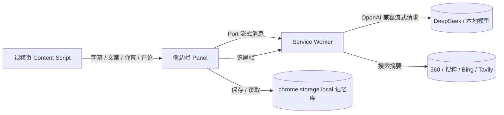

# 视频AI总结 · B站 / 抖音

[](https://developer.chrome.com/docs/extensions/develop/migrate)
[](https://www.microsoft.com/edge)
[](LICENSE)
[](https://github.com/Leslie1168/video-ai-summary-extension/releases)

> 在 **B站 / 抖音** 视频页一键提取字幕、文案、弹幕与评论，用 **DeepSeek**（或任意 OpenAI 兼容模型）生成结构化中文笔记；生成完还能**接着追问**这个视频，可选**联网检索**补资料、**按时间区间识屏**看画面，并把整段对话存进**本地记忆库**随时取回、导出成 Markdown 交接笔记。

这是一个 Manifest V3 的 Edge / Chrome 扩展。所有素材都从你**自己已登录的浏览器**里读取，不需要把账号密码交给任何人；API Key 只保存在浏览器扩展设置里，记忆库只存在本机。

---

## 功能

- **一键总结**：右侧侧边栏自动读取当前视频的字幕 / 文案 / 弹幕 / 热门评论，生成结构化笔记：
  `一句话总结`、`核心要点（带时间戳）`、`关键信息`、`观众视角`、`适合谁看`。
- **B站字幕三渠道自动降级**：
  `player/wbi/v2`（WBI 签名接口）→ `view/conclusion/get`（B站官方 AI 文稿）→ `player/v2`（无签名接口，低置信并标注）。
- **抖音支持**：抖音绝大多数视频没有字幕轨，扩展会基于「文案 + 话题 + 评论区」生成总结，并在结果里明确标注是推断。
- **连续追问**：总结生成后可以针对视频多轮提问，回答**流式输出**；不完整 / 被中断的回答不会混进上下文。
- **联网检索（可选）**：追问时打开「联网检索」，扩展自己搜索网页并把摘要交给模型，回答里附**可点击的来源**；支持 360 / 搜狗 / Bing / Tavily（Tavily 需自己的 Key）。
  - **快速模式**：明确问题直接搜，不额外调用规划模型；360 / Bing / 搜狗并发，取最快可用结果后取消慢请求。
  - **深入模式**：使用你保存的思考强度、上下文与输出配置，最多提交 12 条网页摘要。
  - 检索失败仍会作答，并明确标注「本轮未取得网页，外部补充未联网核实」。
- **处理进度可见**：每条追问上方可展开「处理进度」——搜索词、取得多少条摘要、已用秒数、已输出字数、接口返回的 token 用量。
- **按时间范围识屏**：指定 `03:00`–`03:30` 这类区间，抽 3 / 6 / 8 帧画面连同时间标记交给视觉模型判断；直播、未加载播放器等情况会明确失败。
- **本地记忆库**：按视频 + 对话保存总结、问答、来源、进度和状态，**不再按 10 个视频 / 30 轮自动淘汰**；侧边栏内可搜索、打开任一条记忆继续追问。
- **切换不中断生成**：记忆列表 ↔ 所选记忆 ↔ 本视频之间切换时，各自保留运行实例与连接，回来看到的是持续收到的结果，不是重新发一遍请求。
- **完整交接导出**：把总结、全部追问、搜索词、识屏范围、处理记录、token 用量和未完成事项整理成 Markdown；生成过程中也能导出当时的快照。
- **时间戳跳转**：回答里的 `[03:12]` 点一下，视频跳到对应秒数。
- **三档篇幅**：速览 / 标准 / 精读；支持自定义附加要求。
- **后台版本探活**：扩展代码更新后如果忘了「重新加载」，面板会显示红色提示条并一键重载，避免追问无声卡死。
- 深色界面，时间戳 / 来源 / 流式渲染都在侧边栏内完成。

### 明确的行为边界

- 新建对话**不会**自动读取其他归档；只有你主动打开某条记忆，才接续它的总结与历史对话。
- 联网用于补充、解释、核对和纠错，**不会**把网页上的条目冒充成视频实际说过的内容。
- 「处理进度」是实际发生的工作阶段记录，不是模型内部推理原文，也不是另调一个模型编出来的「假思考」。

---

## 下载

- **打包好的扩展**：到 [Releases](https://github.com/Leslie1168/video-ai-summary-extension/releases) 下载 `video-ai-summary-extension-v1.6.0.zip`；解压后得到 `video-ai-summary-extension` 文件夹，按下面「安装」步骤加载（Edge：`edge://extensions` → 开发人员模式 → 加载解压缩的扩展 → 选中这个文件夹）。
- **源码**：直接 `Code → Download ZIP`，或 `git clone https://github.com/Leslie1168/video-ai-summary-extension.git`。

---

## 安装

### 1. 准备模型 API Key

到 [platform.deepseek.com/api_keys](https://platform.deepseek.com/api_keys) 注册并创建一个 Key（形如 `sk-xxxxxxxx`），充一点点钱就够用很久。
也支持任何 **OpenAI 兼容** 服务（通义、Kimi、智谱、本地 Ollama 等）：在设置页改「接口地址 Base URL」和「模型」即可。

### 2. 加载扩展

**Edge：**

1. 地址栏打开 `edge://extensions/`
2. 打开左下角「**开发人员模式**」
3. 点「**加载解压缩的扩展**」
4. 选中**本仓库文件夹**（也就是包含 `manifest.json` 的那一层），不是它的上级目录
5. 点右上角拼图图标，把「视频AI总结」固定到工具栏

**Chrome：** 打开 `chrome://extensions/`，步骤完全一样。

> 需要 Edge / Chrome **114 或更高版本**（Manifest V3 + sidePanel）。

### 3. 填 Key 并测试

1. 点工具栏上的扩展图标，右侧打开侧边栏
2. 点右上角 **⚙** 打开设置页，粘贴 API Key
3. 点「**测试连接**」，显示「连接正常 ✓」后点「**保存设置**」

---

## 使用

1. 打开任意 B站 / 抖音视频页
2. **如果页面在装扩展之前就已经打开，按一次 `F5` 刷新**（重要）
3. 点扩展图标打开侧边栏 → 自动读取视频信息
4. 选「速览 / 标准 / 精读」→ 点「**生成总结**」
   - 生成过程中可能先显示「模型正在思考…」，这是模型的思考模式，正常
   - 可以随时点「停止」
5. 总结完成后，在底部输入框**继续追问**这个视频；需要外部资料时打开「联网检索」
6. 展开「按时间范围识屏」可以给它几张指定区间的画面看
7. 回答里的 `[03:12]` 时间戳可以点击跳转；「⧉ 复制数据」可以把采集到的原始 JSON 复制出去
8. 点顶部**记忆库图标**可以搜索历史记录、打开某一条继续聊

快捷键：输入框 `Enter` 发送、`Shift + Enter` 换行；当前视频界面 `Ctrl/Cmd + Enter` 直接生成总结（记忆界面不会借此重新总结当前视频）。

### 模型设置怎么调

展开「模型与识屏」控制区，修改后自动保存：

| 项目 | 可选值 | 说明 |
|---|---|---|
| 联网模式 | 快速、深入 | 默认快速 |
| 思考强度 | 关闭、低、高、最高 | 默认关闭；**快速联网会强制关闭** |
| 素材上下文 | 约 1.6 万 / 3.2 万 / 6.4 万 / 12.8 万字 | 按字符计，不等于模型 token 窗口 |
| 历史对话 | 不带历史、最近 4 / 8 / 20 轮 | 只影响发给模型的上下文，不影响归档保存 |
| 单次输出额度 | 8K / 16K / 32K / 64K token | 触顶后按模式决定是否自动续写 |

---

## 支持范围与限制

| 平台 | 字幕 | 弹幕 | 评论 | 说明 |
|---|---|---|---|---|
| B站 | ✅ 三渠道自动降级 | ✅ 采样 | ✅ 热门评论 | B站 AI 字幕只在登录状态下下发 |
| 抖音 | ⚠️ 平台无字幕轨 | — | ✅ 热门评论 | 基于文案 + 话题 + 评论做谨慎推断 |

这些是平台本身的限制，不是扩展故障：

- **B站**：字幕需要登录态（扩展跑在你自己已登录的浏览器里，天然带上，无需额外步骤）。
- **抖音**：绝大多数视频没有字幕轨；部分视频被平台标记为不可分发，任何手段都取不到。
- 无字幕视频的总结会明确标注「基于文案与观众反馈推断」，不要当作逐字稿使用。

识屏同理：它是**区间抽样**，不是逐帧看完整段，短暂闪过的画面可能漏；直播、未加载播放器、受保护视频可能失败。

---

## 隐私与数据

- **API Key**：保存在浏览器扩展设置（`chrome.storage.sync`，可能随浏览器账号同步）和本机；**不会**写进代码、不会上传到本仓库、不会进入交接导出。
- **数据流向**：视频素材（字幕 / 文案 / 弹幕 / 评论）只发送到你配置的模型接口；开启联网检索时，搜索词会发送到对应搜索引擎（360 / 搜狗 / Bing / Tavily），检索摘要随问题一起交给模型；识屏图片只在当前请求期间传给模型接口，**不写入归档**。
- **记忆库**：只存在本机 `chrome.storage.local`，是本地存储、不是云备份。
- **不收集**任何使用数据，没有第三方统计。
- Tavily 的搜索 Key 单独保存在 `chrome.storage.local`，不随浏览器同步。

### 权限说明

| 权限 | 用途 |
|---|---|
| `sidePanel` | 右侧侧边栏界面 |
| `storage` / `unlimitedStorage` | 保存 API Key、偏好、总结与长期记忆（长期记录可能超过普通本地存储额度） |
| `tabs` / `scripting` / `activeTab` | 读取当前标签页地址、向页面注入采集脚本、识屏时截取当前可见标签页 |
| `declarativeNetRequest` | 为 B站字幕请求补充必要请求头（`rules.json`） |
| 站点权限（`bilibili.com` / `douyin.com` / `api.deepseek.com` 等） | 读取视频页素材、调用模型接口 |

---

## 目录结构

```text
.
├── manifest.json          # MV3 清单：权限、侧边栏、内容脚本、DNR 规则
├── background.js          # Service Worker：总结请求代理 / 追问 Port / 权限申请
├── rules.json             # declarativeNetRequest 规则（B站字幕请求头）
├── content/
│   ├── common.js          # 内容脚本公共工具
│   ├── wbi.js             # B站 WBI 签名
│   ├── bilibili.js        # B站视频数据采集
│   ├── douyin-hook.js     # 抖音页面 MAIN world 钩子
│   └── douyin.js          # 抖音视频数据采集
├── lib/
│   ├── llm.js             # OpenAI 兼容流式客户端（分片解码 / 结束原因 / usage / 续写）
│   ├── prompts.js         # 总结提示词与素材组装
│   ├── conversation.js    # 追问上下文组装（历史轮数 / 网页 / 图片）
│   ├── chat-background.js # 追问 Port 服务端：快速模式覆盖、超时、生命周期
│   ├── web-research.js    # 检索词路径选择、轻量规划、合并检索、时间预算
│   ├── search.js          # 360 / 搜狗 / Bing / Tavily 请求、解析、排序
│   ├── archive.js         # 归档字段、存储队列、旧缓存迁移、交接导出
│   └── markdown.js        # 零依赖 Markdown 渲染
├── panel/                 # 侧边栏页面
│   ├── panel.html / panel.js / panel.css
│   ├── chat.js            # 追问 UI、流式展示、进度、快照、记忆载入
│   ├── controls.js        # 模型与识屏控制区自动保存
│   ├── frame-capture.js   # 时间解析、抽帧、截图裁剪、恢复播放器
│   └── studio.css
├── memory/                # 侧边栏内嵌的记忆库（列表 / 搜索 / 独立续聊实例）
├── options/               # 设置页
└── icons/                 # 扩展图标
```

---

## 技术要点

- **Manifest V3 + module Service Worker**：模型请求统一由 `background.js` / `lib/chat-background.js` 代理，页面不直接持有网络请求逻辑。
- **Port 流式转发**：追问使用 `chrome.runtime.connect({ name: 'video-chat' })`，SW 把 SSE 增量逐条 `postMessage` 回侧边栏，实现打字机效果；总结则走 `summarize` Port。
- **流式解析的坑**：正确处理末尾无换行的残留分片、跨分片 UTF-8 中文字符、流内错误、`finish_reason`，并区分正常完成 / 长度触顶 / 内容过滤 / 只有思考没有正文 / 意外断流。
- **素材采集**：B站走 `player/wbi/v2`（WBI 签名）拿字幕，失败降级到官方 AI 文稿与无签名接口；抖音用 MAIN world 钩子拦截页面自身接口响应。
- **两条保存路径必须分离**：`saveConversation()` 写活动视频缓存 + 对应归档；`saveArchive()` 只更新指定归档。这是「同一个视频的不同对话不互相覆盖」的关键。
- **内嵌页面而不是导航**：记忆列表是覆盖层，所选记录用独立内嵌对话页面，按记录 ID 缓存实例，切换时只隐藏不卸载 —— 所以两边可以同时输出。
- **上下文控制**：追问按设置只保留最近 4 / 8 / 20 轮完整问答，素材与总结都有长度上限，避免长对话超出上下文。



---

## 常见问题

**Q：面板提示「读取失败：Could not establish connection. Receiving end does not exist.」**
说明当前视频页还没有注入内容脚本。先在视频页按一次 `F5`，**再点面板右上角的 ↻**（或关掉侧边栏重新打开）让它重新读取；只按 F5 的话，已经打开的侧边栏不会自动重试。

**Q：更新后还是旧界面，或追问没有响应**
最常见的原因是：扩展文件更新过，但浏览器还跑着旧版后台脚本。到 `edge://extensions`（Chrome 为 `chrome://extensions`）点一次「**重新加载**」，然后关掉侧边栏重新打开。**只关闭再打开侧边栏不够**。面板会自动探活：检测到旧后台会在顶部显示红色提示条，点里面的「重新加载扩展」就能修复。

**Q：联网检索要等很久**
先看「处理进度」停在哪一段：规划阶段（含指代的问题，短规划约 6 秒后应回退）→ 搜索阶段（受搜索服务和网络影响，有阶段截止）→ 模型阶段（接口排队或服务故障，首正文计时会终止过久等待）。确认模式是「快速」，也可以手动填写具体搜索词减少指代解析。**不要用「调高输出额度」来解决慢请求。**

**Q：为什么开了快速联网，思考强度选项好像没作用**
快速联网会覆盖思考强度为关闭。要用低 / 高 / 最高思考，请切到「深入」联网。

**Q：为什么模型说「未联网核实」**
本轮没有取得可用网页，或现有网页不支持结论。扩展仍会作答，但要求区分「模型已有知识」和「检索确认的信息」。

**Q：为什么旧记忆续聊不能重新识屏**
归档里没有原始播放器绑定和字幕。若直接采当前网页，可能采到另一个视频。请回到原视频网页，在本视频界面使用识屏。

**Q：为什么导出的文件只到一半**
如果导出时仍在生成，文件是当时那一刻的快照，后续输出不会自动写进已下载的文件。生成完成后再导出一次。

**Q：生成总结时先显示「模型正在思考…」很久**
正常。开启思考模式后，正文到来前会先输出推理内容，长视频会更久一些。

**Q：B站视频没有字幕 / 总结说「素材未提及」**
B站 AI 字幕只在登录状态下下发，确认浏览器里已登录 B站；少数视频确实没有可用字幕。

**Q：抖音总结内容很少**
抖音没有字幕轨，扩展只能基于文案、话题和评论推断，这是平台限制。

**Q：想换模型 / 本地 Ollama**
设置页把「接口地址 Base URL」改成兼容 OpenAI 协议的地址（如 `http://127.0.0.1:11434`），「模型」填对应名称即可，扩展会自动补 `/v1/chat/completions`。非默认可选接口需要在保存时授权对应站点权限。**识屏需要模型本身支持图片输入**，官方接口下请使用 `deepseek-flash`。

**Q：记忆少了，能恢复以前的对话吗**
能迁移的是当前仍在本地 / 会话缓存里的旧记录。早先已被淘汰、扩展被卸载或配置目录被清除的数据不保证能恢复；已有的 Markdown / JSON 下载可以作为人工回顾依据。当前也没有实现 JSON 一键导入。

---

## 更新日志

### v1.6.0（2026-10-26）
- 新增**完整交接导出**：总结 + 全部追问 + 搜索词 + 识屏范围 + 处理记录 + token 用量 + 未完成状态，一次导出成 Markdown；生成过程中导出的是快照。另有「全部下载 · Markdown」与「全部打包 · JSON」。
- 记忆库改为**侧边栏内嵌**：在侧边栏内搜索、打开、继续追问，不再跳新窗口 / 新标签页。
- 打开某条记忆时接续它的总结与历史对话；在该记忆里追问只更新这条归档，不覆盖当前视频的活动缓存。
- **切换保持生成**：记忆列表 ↔ 记忆对话 ↔ 本视频之间切换时保留实例、请求与连接，回来看到的是持续结果。
- 归档不再按「最近 10 个视频 / 每视频 30 轮」自动淘汰，新增 `unlimitedStorage` 权限；旧缓存会被迁入记忆库且不删除原数据。

### v1.5.0
- 新增**快速联网**：明确问题直接搜、不额外调用规划模型；360 / Bing / 搜狗并发取最快可用结果，取消慢请求。
- 新增**处理进度**面板：阶段日志、已用时间、已输出字数、接口返回 token 用量。
- 追问路径增加超时保护：搜索规划约 6 秒、搜索阶段约 8 秒、快速模式首正文约 45 秒、其他约 90 秒、整体约 180 秒。

### v1.4.2
- 联网检索改为「补充与纠错」定位：搜索词由问题或素材解析生成，不再机械拼接完整标题与上一轮问题。
- 检索失败时不再退化成只依据视频，而是照常作答并标注未联网核实。
- 移除按关键词重合度硬性拒答的旧逻辑。

### v1.4.0
- 新增**长期记忆库**与批量下载 / 打包，移除旧的自动淘汰规则。
- 修复旧搜索词污染新问题的问题。

### v1.3.0
- 新增思考强度、素材上下文、历史轮数、单次输出额度控制。
- 新增**按时间范围识屏**：指定区间抽 3 / 6 / 8 帧交给视觉模型，自动暂停、跳转、恢复播放位置。
- 输出截断识别与续写入口。

### v1.2.2（2026-10-21）
- 修复「追问永远卡在正在准备回答」：新增后台版本探活（ping/pong）、面板红色提示条 + 一键重新加载、追问首条响应 12 秒兜底报错。
- 追问缓存改为 `storage.session` + `storage.local` 双写；重新加载扩展前自动迁移缓存，总结与对话尽量不丢。
- 设置页补充「更新扩展后必须重新加载」的使用提示。

### v1.2.1（2026-10-19）
- 新增连续追问（流式）、联网搜索与可点击来源、追问缓存。
- 新增追问的上下文与提示词约束（区分视频观点与观众观点、不编造来源）。

### v1.1.0（2026-10-15）
- B站字幕改为三渠道自动降级（WBI 签名 / 官方 AI 文稿 / 无签名低置信）。
- 提示词与素材组装优化，支持自定义附加要求。

### v1.0.0（2026-10-03）
- 首个版本：B站 / 抖音视频信息采集、结构化 AI 总结、侧边栏与设置页。

---

## 已知未覆盖

- 不同 B站 / 抖音播放器版本、分集与特殊播放页的识屏行为。
- 侧边栏关闭、浏览器退出、扩展重载后请求继续运行 —— **当前没有该保证**。
- JSON 一键导入与自动冲突合并 —— 尚未实现。
- 超大规模记忆库的分页与索引。

---

## 免责声明

本项目仅用于个人学习与内容整理。请遵守 B站 / 抖音的服务条款与内容版权，不要用于批量抓取、商业转载或其他侵权用途；生成结果仅供参考。

## 许可

[MIT](LICENSE) © 2026 Ellen
