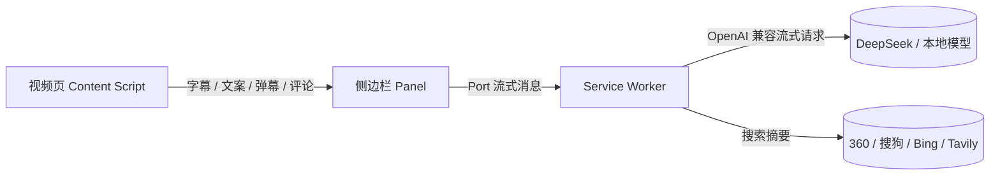

# 视频AI总结 · B站 / 抖音

[](https://developer.chrome.com/docs/extensions/develop/migrate)
[](https://www.microsoft.com/edge)
[](LICENSE)

> 在 **B站 / 抖音** 视频页一键提取字幕、文案、弹幕与评论，用 **DeepSeek**（或任意 OpenAI 兼容模型）生成结构化中文笔记；生成完还能**接着追问**这个视频，并可选**联网搜索**补资料。

这是一个 Manifest V3 的 Edge / Chrome 扩展。所有素材都从你**自己已登录的浏览器**里读取，不需要把账号密码交给任何人；API Key 只保存在浏览器扩展设置里。

---

## 功能

- **一键总结**：右侧侧边栏自动读取当前视频的字幕 / 文案 / 弹幕 / 热门评论，生成结构化笔记：
  `一句话总结`、`核心要点（带时间戳）`、`关键信息`、`观众视角`、`适合谁看`。
- **B站字幕三渠道自动降级**：
  `player/wbi/v2`（WBI 签名接口）→ `view/conclusion/get`（B站官方 AI 文稿）→ `player/v2`（无签名接口，低置信并标注）。
- **抖音支持**：抖音绝大多数视频没有字幕轨，扩展会基于「文案 + 话题 + 评论区」生成总结，并在结果里明确标注是推断。
- **连续追问**：总结生成后可以针对视频多轮提问，回答**流式输出**；不完整 / 被中断的回答不会混进上下文。
- **联网搜索（可选）**：追问时打开「联网搜索」，会检索网页并把摘要交给模型，回答里附**可点击的来源**；支持 360 / 搜狗 / Bing / Tavily（Tavily 需自己的 Key）。
- **时间戳跳转**：回答里的 `[03:12]` 点一下，视频跳到对应秒数。
- **三档篇幅**：速览 / 标准 / 精读；支持自定义附加要求。
- **本地缓存**：最近 10 个视频的总结与对话缓存在 `chrome.storage.local`，重新打开同一视频可恢复。
- **后台版本探活**：扩展代码更新后如果忘了「重新加载」，面板会显示红色提示条并一键重载，避免追问无声卡死。
- 深色界面，时间戳 / 来源 / 流式渲染都在侧边栏内完成。

---

## 安装

### 1. 准备模型 API Key

到 [platform.deepseek.com/api_keys](https://platform.deepseek.com/api_keys) 注册并创建一个 Key（形如 `sk-xxxxxxxx`），充一点点钱就够用很久。
也支持任何 **OpenAI 兼容** 服务（通义、Kimi、智谱、本地 Ollama 等）：在设置页改「接口地址 Base URL」和「模型」即可。

### 2. 加载扩展

**Edge：**

1. 地址栏打开 `edge://extensions/`
2. 打开左下角「**开发人员模式**」
3. 点「**加载解压缩的扩展**」
4. 选中**本仓库文件夹**（也就是包含 `manifest.json` 的那一层），不是它的上级目录
5. 点右上角拼图图标，把「视频AI总结」固定到工具栏

**Chrome：** 打开 `chrome://extensions/`，步骤完全一样。

> 需要 Edge / Chrome **114 或更高版本**（Manifest V3 + sidePanel）。

### 3. 填 Key 并测试

1. 点工具栏上的扩展图标，右侧打开侧边栏
2. 点右上角 **⚙** 打开设置页，粘贴 API Key
3. 点「**测试连接**」，显示「连接正常 ✓」后点「**保存设置**」

---

## 使用

1. 打开任意 B站 / 抖音视频页
2. **如果页面在装扩展之前就已经打开，按一次 `F5` 刷新**（重要）
3. 点扩展图标打开侧边栏 → 自动读取视频信息
4. 选「速览 / 标准 / 精读」→ 点「**生成总结**」
   - 生成过程中会先显示「模型正在思考…」，这是 deepseek-flash 的思考模式，正常
   - 可以随时点「停止」
5. 总结完成后，在底部输入框**继续追问**这个视频；需要外部资料时点「联网搜索」
6. 回答里的 `[03:12]` 时间戳可以点击跳转；「⧉ 复制数据」可以把采集到的原始 JSON 复制出去

快捷键：侧边栏里按 `Ctrl/Cmd + Enter` 可直接生成总结；输入框 `Enter` 发送、`Shift + Enter` 换行。

---

## 支持范围与限制

| 平台 | 字幕 | 弹幕 | 评论 | 说明 |
|---|---|---|---|---|
| B站 | ✅ 三渠道自动降级 | ✅ 采样 | ✅ 热门评论 | B站 AI 字幕只在登录状态下下发 |
| 抖音 | ⚠️ 平台无字幕轨 | — | ✅ 热门评论 | 基于文案 + 话题 + 评论做谨慎推断 |

这些是平台本身的限制，不是扩展故障：

- **B站**：字幕需要登录态（扩展跑在你自己已登录的浏览器里，天然带上，无需额外步骤）。
- **抖音**：绝大多数视频没有字幕轨；部分视频被平台标记为不可分发，任何手段都取不到。
- 无字幕视频的总结会明确标注「基于文案与观众反馈推断」，不要当作逐字稿使用。

---

## 隐私与数据

- **API Key**：保存在浏览器扩展设置（`chrome.storage.sync`，可能随浏览器账号同步）和本机；**不会**写进代码、不会上传到本仓库。
- **数据流向**：视频素材（字幕 / 文案 / 弹幕 / 评论）只发送到你配置的模型接口；开启联网搜索时，问题与视频标题会发送到对应搜索引擎（360 / 搜狗 / Bing / Tavily），检索摘要随问题一起交给模型。
- **不收集**任何使用数据，没有第三方统计。
- Tavily 的搜索 Key 单独保存在 `chrome.storage.local`，不随浏览器同步。

### 权限说明

| 权限 | 用途 |
|---|---|
| `sidePanel` | 右侧侧边栏界面 |
| `storage` | 保存 API Key、偏好、总结与对话缓存 |
| `tabs` / `scripting` | 读取当前标签页地址、向页面注入采集脚本 |
| `declarativeNetRequest` | 为 B站字幕请求补充必要请求头（`rules.json`） |
| 站点权限（`bilibili.com` / `douyin.com` / `api.deepseek.com` 等） | 读取视频页素材、调用模型接口 |

---

## 目录结构

```text
.
├── manifest.json          # MV3 清单：权限、侧边栏、内容脚本、DNR 规则
├── background.js          # Service Worker：总结请求代理 / 追问 Port / 权限申请
├── rules.json             # declarativeNetRequest 规则（B站字幕请求头）
├── content/
│   ├── common.js          # 内容脚本公共工具
│   ├── wbi.js             # B站 WBI 签名
│   ├── bilibili.js        # B站视频数据采集
│   ├── douyin-hook.js     # 抖音页面 MAIN world 钩子
│   └── douyin.js          # 抖音视频数据采集
├── lib/
│   ├── llm.js             # OpenAI 兼容流式客户端
│   ├── prompts.js         # 总结提示词与素材组装
│   ├── conversation.js    # 追问上下文组装
│   ├── chat-background.js # 追问 Port 服务端
│   ├── search.js          # 联网搜索与结果解析
│   └── markdown.js        # 零依赖 Markdown 渲染
├── panel/                 # 侧边栏页面
│   ├── panel.html / panel.js / panel.css
│   ├── chat.js            # 追问 UI、探活与缓存
│   └── studio.css
├── options/               # 设置页
└── icons/                 # 扩展图标
```

---

## 技术要点

- **Manifest V3 + module Service Worker**：模型请求统一由 `background.js` 代理，页面不直接持有网络请求逻辑。
- **Port 流式转发**：追问使用 `chrome.runtime.connect({ name: 'video-chat' })`，SW 把 SSE 增量逐条 `postMessage` 回侧边栏，实现打字机效果；总结则走 `summarize` Port。
- **素材采集**：B站走 `player/wbi/v2`（WBI 签名）拿字幕，失败降级到官方 AI 文稿与无签名接口；抖音用 MAIN world 钩子拦截页面自身接口响应。
- **上下文控制**：追问只保留最近 8 轮完整问答，素材与总结都有长度上限，避免长对话超出上下文。
- **稳定性**：追问首条响应 12 秒兜底、后台版本探活、扩展重载前缓存迁移（`storage.session` 会被重载清空，所以缓存双写 `storage.local`）。



---

## 常见问题

**Q：面板提示「读取失败：Could not establish connection. Receiving end does not exist.」**
说明当前视频页还没有注入内容脚本。先在视频页按一次 `F5`，**再点面板右上角的 ↻**（或关掉侧边栏重新打开）让它重新读取；只按 F5 的话，已经打开的侧边栏不会自动重试。

**Q：追问一直停在「正在准备回答…」，没有报错**
最常见的原因是：扩展代码更新过，但浏览器还跑着旧版后台脚本。到 `edge://extensions`（Chrome 为 `chrome://extensions`）点一次「**重新加载**」，然后关掉侧边栏重新打开即可。
v1.2.2 起面板会自动探活：检测到旧后台会在顶部显示红色提示条，点里面的「重新加载扩展」就能修复。

**Q：生成总结时先显示「模型正在思考…」很久**
正常。deepseek-flash 默认开启思考模式，正文到来前会先输出推理内容，长视频会更久一些。

**Q：B站视频没有字幕 / 总结说「素材未提及」**
B站 AI 字幕只在登录状态下下发，确认浏览器里已登录 B站；少数视频确实没有可用字幕。

**Q：抖音总结内容很少**
抖音没有字幕轨，扩展只能基于文案、话题和评论推断，这是平台限制。

**Q：想换模型 / 本地 Ollama**
设置页把「接口地址 Base URL」改成兼容 OpenAI 协议的地址（如 `http://127.0.0.1:11434`），「模型」填对应名称即可，扩展会自动补 `/v1/chat/completions`。非默认可选接口需要在保存时授权对应站点权限。

**Q：更新扩展文件后要做什么**
到扩展管理页点一次「重新加载」，并刷新已打开的视频页。**只改文件不重新加载，Service Worker 仍然是旧代码**——这是开发这个扩展最容易踩的坑。

---

## 更新日志

### v1.2.2（2026-10-21）
- 修复「追问永远卡在正在准备回答」：新增后台版本探活（ping/pong）、面板红色提示条 + 一键重新加载、追问首条响应 12 秒兜底报错。
- 追问缓存改为 `storage.session` + `storage.local` 双写；重新加载扩展前自动迁移缓存，总结与对话尽量不丢。
- 设置页补充「更新扩展后必须重新加载」的使用提示。

### v1.2.1（2026-10-19）
- 新增连续追问（流式）、联网搜索与可点击来源、追问缓存。
- 新增追问的上下文与提示词约束（区分视频观点与观众观点、不编造来源）。

### v1.1.0（2026-10-15）
- B站字幕改为三渠道自动降级（WBI 签名 / 官方 AI 文稿 / 无签名低置信）。
- 提示词与素材组装优化，支持自定义附加要求。

### v1.0.0（2026-10-03）
- 首个版本：B站 / 抖音视频信息采集、结构化 AI 总结、侧边栏与设置页。

---

## 免责声明

本项目仅用于个人学习与内容整理。请遵守 B站 / 抖音的服务条款与内容版权，不要用于批量抓取、商业转载或其他侵权用途；生成结果仅供参考。

## 许可

[MIT](LICENSE) © 2026 Ellen
